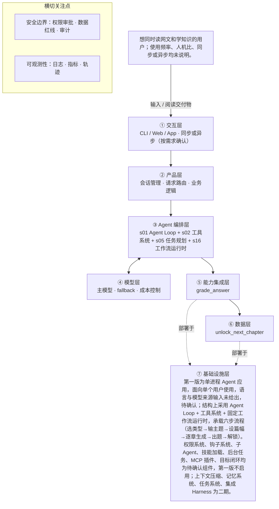

# PRD 推导方案 ——「网文阅读 × 学习关卡」

> 状态：方案待确认（Step 1–4 已完成，Step 5 代码生成需确认后启动）
> 推导引擎：Agent Blueprint · 模型：anthropic

## 产品定位（一句话）

**网文阅读 × 学习关卡**：给想边追网文边学知识的人：选类型 + 输入学习主题，系统按章生成个性化小说与配套测验，答对才能解锁下一章。

## ⚠️ 待确认清单（答不上就是风险点）

1. 这款产品要达成的一句话目标是什么？怎样算做成（例如完读率、答题正确率、学习留存）？
2. 目标用户是谁？他们的使用频率如何？交互是同步等待生成，还是异步（先提交后回来读）？
3. 一次完整交付的确切边界是什么？是单章「故事+题目」，还是整本多章连载？
4. 需要调用哪些外部系统、API 或数据源（例如模型服务、题库、账号体系、内容审核）？
5. 领域知识放在哪里？不同学习主题（AI、英语等）的规则、文档、题目生成标准由谁提供？
6. 有哪些绝对不能做的事？包括内容安全红线、未成年人保护、版权与数据隐私合规约束。
7. 失败时怎么办？模型生成失败、题目有幻觉、超时、用户反复答错时的降级策略是什么？
8. 怎么衡量成功？请给出可度量指标：完成率、单章生成时延、每题成本、答题准确率等。
9. 成功标准的可量化指标是什么（输入未给出）
10. 目标用户规模、使用频率、人机比是同步还是异步（输入未给出）
11. 安全红线、数据边界与合规约束是什么（输入未给出）
12. 时延、并发、成本、可用模型等约束是什么（输入未给出）
13. 学习主题知识的具体来源形态（自建语料 / 模型内置知识 / 检索文档）
14. 生成内容与学习主题一致性、题目与章节对应关系的质量校验方式
15. 生成内容是否需内容安全审核及审核标准
16. 用户作答数据与学习进度的存储范围与留存策略
17. 学习主题知识是否需要按需加载的庞大知识库（技能加载是否启用）
18. 是否需要审计、拦截、埋点、合规记录（钩子系统是否启用）
19. 是否存在耗时较长的生成任务需后台执行（后台任务是否启用）
20. 是否需要接入外部工具生态（MCP 插件是否启用）
21. 章节解锁是否被认定为敏感写入操作，权限系统是否需启用
22. 是否需要自动判定「何时算完成」（目标闭环是否启用）
23. 【组件 s03 权限系统】是否涉及破坏性或敏感操作（删除、写入外部系统、支付、发送消息、隐私数据）？
24. 【组件 s04 钩子系统】是否需要审计、拦截、埋点、合规记录？
25. 【组件 s06 子 Agent】是否会出现上下文爆炸的子任务，或可并行的探索型子任务？
26. 【组件 s07 技能加载】领域知识库是否庞大、需要按需加载？
27. 【组件 s11 后台任务】是否有耗时几分钟以上的慢操作需要不阻塞主流程？
28. 【组件 s14 MCP 插件】是否需要接入外部工具生态（MCP、第三方插件）？
29. 【组件 s17 目标闭环】是否需要自动判断「何时算完成」（独立评估器）？

## Step 1 · 需求拆解（提取硬事实）

| 维度 | 结论 | 状态 | 出处 |
|---|---|---|---|
| 目标 | 把「追网文的爽感」和「学习打卡」结合，让用户边追更边学东西；成功标准为可量化指标，输入未给出。 | 待确认 | 把「追网文的爽感」和「学习打卡」结合，让用户边追更边学东西 |
| 用户 | 想同时读网文和学知识的用户；使用频率、人机比、同步或异步均未说明。 | 待确认 | 让用户边追更边学东西 |
| 核心闭环 | 用户选小说类型 → 输入想学的主题 → 设定章节数与每章篇幅 → 系统按章生成故事 → 每章读完出题 → 答对解锁下一章。 | 明确 | 用户先选小说类型（爽文、言情、都市等）；再输入想学的主题（如 AI、英语）；可设定章节数与每章篇幅；系统按章生成故事；每章读完后出题，答对才能解锁下一章 |
| 交付物 | 按章生成的小说正文 + 每章配套测验题目；可能还包括单知识点短篇。 | 明确 | 系统按章生成故事；每章读完后出题；支持只输入一个词或知识点，立刻生成对应短篇与测验 |
| 边界 | 输入未给出任何明确不能做的事情（安全红线、数据边界、合规约束）。 | 待确认 |  |
| 约束 | 输入未给出时延、并发、合规、成本、可用模型等约束。 | 待确认 |  |

## Step 2 · 领域建模（映射 Harness 五要素）

| 要素 | 内容 |
|---|---|
| **工具** | 文本生成能力：按用户设定的小说类型、学习主题、章节数与每章篇幅生成章节故事正文。；测验生成能力：为已生成的每一章故事产出配套测验题目。；短篇生成能力：在用户只输入一个词或知识点时，生成对应短篇与测验。；章节解锁控制：校验用户测验作答结果，答对后解锁下一章，属于对用户学习进度的写入动作。 |
| **知识** | 用户指定的学习主题知识（如 AI、英语），是出题与内容正确性的知识来源。；小说类型设定（爽文、言情、都市等）对应的文体与叙事规则，用于约束故事生成风格。；用户设定的章节数与每章篇幅参数，构成生成任务的规格约束。；知识来源具体形态（自建语料、外部模型内置知识还是检索文档）输入未给出，待确认。 |
| **观察** | 用户测验作答的对错结果，是判定能否解锁下一章的唯一可观测信号。；已生成章节正文与配套题目，是可复核的交付物产出记录。；用户当前所处章节与解锁进度状态，用于确认解锁动作是否生效。；生成内容与学习主题是否一致、题目是否对应本章内容的质量校验方式，输入未给出，待确认。 |
| **行动** | 以对话或表单形式接收用户输入：小说类型、学习主题、章节数、每章篇幅。；以文本形式向用户按章下发故事正文与测验题目。；以作答提交的方式回收用户答案并返回判定结果与解锁与否。；只输入一个词或知识点时直接触发生成短篇与测验的快捷动作。 |
| **权限** | 章节解锁属于对用户进度的状态写入，需通过「测验答对」这一条件校验后才允许执行，未通过时默认拒绝解锁。；生成内容会呈现给用户，涉及对外输出，需确认是否需要内容安全审核，输入未给出，待确认。；用户作答数据与学习进度的存储范围与留存策略，输入未给出，待确认。；输入未声明任何不可触碰的数据或安全红线，该边界待确认。 |

## Step 3 · 组件选型（宁可少选）

| 组件 | 选否 | 理由 | 参考 |
|---|---|---|---|
| s01 Agent Loop | ✅ 必选 | 一切基础：循环 + 工具（一切基础，恒选） | s01_agent_loop/README.md |
| s02 工具系统 | ✅ 必选 | 需要调用外部系统/API/数据源（一切基础，恒选） | s02_tool_use/README.md |
| s03 权限系统 | ❓ 待确认 | 输入未说明：是否涉及破坏性或敏感操作（删除、写入外部系统、支付、发送消息、隐私数据）？ | s03_permission/README.md |
| s04 钩子系统 | ❓ 待确认 | 输入未说明：是否需要审计、拦截、埋点、合规记录？ | s04_hooks/README.md |
| s05 任务规划 | ✅ 必选 | 流程包含选类型→输入主题→设定篇幅→逐章生成→出题→解锁下一章，天然多步骤且需跟踪进度。 | s05_todo_write/README.md |
| s06 子 Agent | ❓ 待确认 | 输入未说明：是否会出现上下文爆炸的子任务，或可并行的探索型子任务？ | s06_subagent/README.md |
| s07 技能加载 | ❓ 待确认 | 输入未说明：领域知识库是否庞大、需要按需加载？ | s07_skill_loading/README.md |
| s08 上下文压缩 | ⏸ 二期 | 多章连载 + 逐章测验暗示单会话可能较长，但输入未明确要求长会话管理。 | s08_context_compact/README.md |
| s09 记忆系统 | ⏸ 二期 | 「追更」暗示需要记住阅读进度与学习主题，但输入未明确要求跨会话记忆用户偏好。 | s09_memory/README.md |
| s10 任务系统 | ⏸ 二期 | 章节数与解锁进度暗示目标需持久化以支持断点续读，但输入未明确要求。 | s10_task_system/README.md |
| s11 后台任务 | ❓ 待确认 | 输入未说明：是否有耗时几分钟以上的慢操作需要不阻塞主流程？ | s11_background_tasks/README.md |
| s12 定时调度 | ❌ 放弃 | 输入描述的是用户主动触发的生成与阅读，未提及定时自动触发。 | s12_cron_scheduler/README.md |
| s13 Agent 团队 | ❌ 放弃 | 产品形态是面向单个用户的线性阅读闯关，未提及多 Agent 并行隔离工作区。 | s13_agent_teams/README.md |
| s14 MCP 插件 | ❓ 待确认 | 输入未说明：是否需要接入外部工具生态（MCP、第三方插件）？ | s14_mcp_plugin/README.md |
| s15 集成 Harness | ⏸ 二期 | 含二期共 5 个可选组件，二期集成时需要 | s15_integrated_harness/README.md |
| s16 工作流运行时 | ✅ 必选 | 核心玩法为固定的六步流程（选类型→输主题→设篇幅→生成→出题→解锁），适合写死成工作流。 | s16_workflow_runtime/README.md |
| s17 目标闭环 | ❓ 待确认 | 输入未说明：是否需要自动判断「何时算完成」（独立评估器）？ | s17_goal_loop/README.md |

特征判定依据：

- `destructive_ops` = unknown：输入未提及删除、写入外部系统、支付、发送消息或隐私数据处理。
- `audit_needed` = unknown：输入未提及审计、拦截、埋点或合规记录需求。
- `multi_step` = yes：流程包含选类型→输入主题→设定篇幅→逐章生成→出题→解锁下一章，天然多步骤且需跟踪进度。
- `context_heavy` = unknown：输入未说明单章/整本篇幅规模与是否出现上下文爆炸或可并行子任务。
- `large_knowledge` = unknown：输入只说输入学习主题（如 AI、英语），未说明是否需要庞大领域知识库按需加载。
- `long_sessions` = later：多章连载 + 逐章测验暗示单会话可能较长，但输入未明确要求长会话管理。
- `cross_session_memory` = later：「追更」暗示需要记住阅读进度与学习主题，但输入未明确要求跨会话记忆用户偏好。
- `persistent_goals` = later：章节数与解锁进度暗示目标需持久化以支持断点续读，但输入未明确要求。
- `slow_operations` = unknown：输入未说明生成一章或一套测验的耗时量级。
- `scheduled` = no：输入描述的是用户主动触发的生成与阅读，未提及定时自动触发。
- `parallel_isolated` = no：产品形态是面向单个用户的线性阅读闯关，未提及多 Agent 并行隔离工作区。
- `external_ecosystem` = unknown：输入未提及 MCP、第三方插件或外部工具生态接入。
- `fixed_orchestration` = yes：核心玩法为固定的六步流程（选类型→输主题→设篇幅→生成→出题→解锁），适合写死成工作流。
- `auto_completion` = unknown：输入只说明「答对才解锁下一章」的判定，未提及由独立评估器自动判断整体完成。

## Step 4 · 架构设计

### 分层架构图（7 层 + 数据流）



| 层 | 名称 | 回答的问题 | 落地锚点 |
|---|---|---|---|
| ① | 交互层 | 谁在用、怎么用？ | CLI / Web / App / API；同步或异步；人机比 |
| ② | 产品层 | 产品外壳是什么？ | 会话管理、请求路由、账户、业务逻辑 |
| ③ | Agent 编排层 | Harness 如何运转？ | loop、工具分发、hooks、权限、记忆、任务、技能、压缩、子 agent / 团队、目标闭环 |
| ④ | 模型层 | 智能从哪来？ | 主模型、辅助模型、路由、fallback、成本 |
| ⑤ | 能力集成层 | 如何触达外部世界？ | 内部工具、MCP server、知识库、第三方 API |
| ⑥ | 数据层 | 什么需要持久化？ | 记忆、任务、会话历史、轨迹数据、日志指标 |
| ⑦ | 基础设施层 | 如何部署运行？ | 单进程 / 服务 / 团队、沙箱、队列、调度、监控 |

### 工具清单

| 工具 | 输入 | 输出 | 副作用 | 权限 | 归属层 |
|---|---|---|---|---|---|
| `collect_story_config` | 用户提供的小说类型（如爽文、言情、都市）、学习主题（如 AI、英语）、章节数、每章篇幅 | 结构化的生成规格对象（类型、主题、章节数、篇幅） | 无持久化写入，仅会话内参数记录 | allow | ③ |
| `generate_chapter` | 生成规格（类型、学习主题、章节序号、篇幅）+ 已生成章节的上下文摘要 | 该章小说正文文本 | 产出章节正文并写入会话产出记录；不对外部系统写入 | allow | ④ |
| `generate_quiz` | 指定章节的正文文本 + 学习主题 | 该章配套测验题目（题干、选项/作答形式、正确答案） | 产出题目并写入会话产出记录 | allow | ④ |
| `generate_short_piece` | 用户输入的单个词或知识点 | 对应短篇正文与配套测验 | 产出短篇与题目并写入会话产出记录 | allow | ④ |
| `grade_answer` | 用户对当前章测验的作答内容 + 该章题目标准答案 | 对错判定结果与错题反馈 | 记录本次作答结果到会话进度状态 | allow | ⑤ |
| `unlock_next_chapter` | 当前章节序号 + 该章测验判定结果 | 解锁成功/拒绝的确认与新的当前章节序号 | 写入用户阅读与解锁进度状态；判定未通过时必须拒绝 | ask | ⑥ |
| `read_progress` | 用户标识或会话标识 | 当前所处章节、已解锁章节列表、已生成章节与题目记录 | 只读，无写入 | allow | ② |

### 系统提示词草案

```
你是「网文阅读 × 学习关卡」助手的 Harness 执行体。

身份：面向单个用户，按章生成个性化小说与配套测验，用户答对测验才能解锁下一章。

规则：
1. 严格按用户设定的小说类型、学习主题、章节数、每章篇幅生成；参数缺失时必须先向用户询问补齐，不得自行臆造。
2. 先出章节正文，再出该章配套测验，题目必须对应本章内容与用户指定学习主题。
3. 边界：解锁下一章只能在用户测验判定为「答对」后执行；判定未通过或结果不确定时一律拒绝解锁。
4. 质量底线：不得编造输入中不存在的设定参数、知识来源与用户信息；知识正确性无法确认时须标注「待确认」并提示用户核实，不得假装确定。
5. 内容安全：输出前自检是否含违规内容；输入未给出安全红线，遇疑似风险内容应停止生成并告知用户。

工具说明：collect_story_config 收集生成规格；generate_chapter 生成章节正文；generate_quiz 生成章节测验；generate_short_piece 由单词/知识点生成短篇与测验；grade_answer 判定作答；unlock_next_chapter 解锁下一章；read_progress 读取进度。

知识目录：①用户指定的学习主题知识（正确性来源，具体形态待确认）；②小说类型文体与叙事规则；③用户设定的章节数与篇幅规格。知识来源形态未确认前，不得声称已接入外部权威语料。
```

### 上下文与记忆策略

会话内：保留生成规格（类型、主题、章节数、篇幅）、已完成章节的正文摘要与题目要点、当前章节序号、未通过的错题记录，按章滚动压缩已读完章节的全文为要点摘要，避免单会话上下文线性膨胀。跨会话：第一版不持久化，属输入未明确要求，列入待确认；若后续要求「追更」，需持久化阅读与解锁进度、学习主题与用户偏好，由记忆系统/任务系统支撑，均为二期组件。

### 安全边界与降级策略

- 工具失败（如 generate_chapter、generate_quiz 调用失败）→ 向用户明确报错并保留已生成内容，不静默跳过，允许重试，不得用旧章节内容冒充新章。
- 模型幻觉（生成知识性内容或题目答案可能不准确）→ 输出前自检题目与章节内容对应关系，知识正确性无法确认时标注「待确认」并提示用户核实，不得声称已接入权威语料。
- 超时（生成耗时过长或用户长时间无响应）→ 告知用户当前进度，保留已完成的章节与题目，不丢状态；具体时延约束输入未给出，待确认。
- 越权（未通过测验却请求解锁下一章）→ 拒绝解锁并返回原因，仅当 grade_answer 判定为答对时才允许 unlock_next_chapter 写入进度。
- 参数缺失或非法（章节数、篇幅、类型、主题未给或越界）→ 先追问补齐，不自行脑补生成。
- 内容安全风险（生成内容疑似违规）→ 停止下发并提示用户，是否需独立审核环节输入未给出，待确认。
- 知识来源不明（学习主题对应知识无可靠来源）→ 降级为通用讲解并标注来源不确定，禁止编造权威出处。
- 用户数据与进度存储范围未定 → 第一版仅在会话内维护，不做跨会话留存，待确认后再决定。

### 可观测性

- 日志：每次生成规格收集（类型、主题、章节数、篇幅）的入参与结果；每章正文与题目生成的成功/失败与耗时；每次作答判定结果（对/错）与解锁动作的允许/拒绝记录；错误与降级事件（工具失败、幻觉自检命中、越权拒绝、超时）
- 指标：生成成功率（章节正文、题目、短篇分项统计）；测验作答正确率与解锁拒绝次数；单章生成与判定的耗时分布；会话内平均章节数与放弃点分布
- 轨迹：按会话记录完整轨迹：每次用户输入、工具调用（名称、入参、出参摘要）、判定结果与解锁动作，按时间顺序追加，用于复现「选类型→生成→出题→判定→解锁」全过程。

### 技术栈与部署形态

第一版为单进程 Agent 应用，面向单个用户使用，语言与模型来源输入未给出，待确认；结构上采用 Agent Loop + 工具系统 + 固定工作流运行时，承载六步流程（选类型→输主题→设篇幅→逐章生成→出题→解锁）。权限系统、钩子系统、子 Agent、技能加载、后台任务、MCP 插件、目标闭环均为待确认组件，第一版不启用；上下文压缩、记忆系统、任务系统、集成 Harness 为二期。

## 验收标准对照（可落地 vs demo）

| 标准 | 要求 | 本方案的对应设计 |
|---|---|---|
| 可运行 | 一条命令能起，配置与密钥外置（.env / config） | 第一版为单进程 Agent 应用，面向单个用户使用，语言与模型来源输入未给出，待确认；结构上采用 Agent Loop + 工具系统 + 固定工作流运行时，承载六步流程（选类型→输主题→设篇幅→逐章生成→出题→解锁）。权限系统、钩子系统、子 Agent、技能加载、后台任务、MCP 插件、目标闭环均为待确认组件，第一版不启用；上下文压缩、记忆系统、任务系统、集成 Harness 为二期。 |
| 可容错 | 工具失败、模型幻觉、超时、越权都有明确降级路径 | 工具失败（如 generate_chapter、generate_quiz 调用失败）→ 向用户明确报错并保留已生成内容，不静默跳过，允许重试，不得用旧章节内容冒充新章。；模型幻觉（生成知识性内容或题目答案可能不准确）→ 输出前自检题目与章节内容对应关系，知识正确性无法确认时标注「待确认」并提示用户核实，不得声称已接入权威语料。；超时（生成耗时过长或用户长时间无响应）→ 告知用户当前进度，保留已完成的章节与题目，不丢状态；具体时延约束输入未给出，待确认。 |
| 可观测 | 有日志、有指标、有轨迹数据 | 每次生成规格收集（类型、主题、章节数、篇幅）的入参与结果；每章正文与题目生成的成功/失败与耗时；生成成功率（章节正文、题目、短篇分项统计）；测验作答正确率与解锁拒绝次数 |
| 可测试 | 核心循环与工具分派有单测，权限与安全有边界测试 | Step 5 骨架层需附核心循环与权限边界的单测 |
| 可部署 | 有明确的部署形态（单进程 / 服务 / 团队）与启动文档 | 第一版为单进程 Agent 应用，面向单个用户使用，语言与模型来源输入未给出，待确认；结构上采用 Agent Loop + 工具系统 + 固定工作流运行时，承载六步流程（选类型→输主题→设篇幅→逐章生成→出题→解锁）。权限系统、钩子系统、子 Agent、技能加载、后台任务、MCP 插件、目标闭环均为待确认组件，第一版不启用；上下文压缩、记忆系统、任务系统、集成 Harness 为二期。 |
| 可度量 | 有对齐 PRD 的成功指标，并能采集 | 生成成功率（章节正文、题目、短篇分项统计）；测验作答正确率与解锁拒绝次数；单章生成与判定的耗时分布；会话内平均章节数与放弃点分布 |

## 独立审稿意见

- 结论：✅ 通过（82 / 100），设计稿共 1 版
- 总评：整体结构与五要素映射清晰，绝大多数事实性陈述都能回溯到输入或已标注待确认，六条验收标准中可运行、可容错、可观测、可测试、可度量均有对应设计骨架。主要不足在于内容安全与题目正确性缺少可执行的校验路径、多会话解锁进度在二期前无降级方案、成功指标未对齐 PRD，故未给高分。未发现需要判定为 ok=false 的 high 级问题。
- [medium] design.security_and_degradation：内容安全降级不彻底：输入未给出安全红线，方案采取「疑似风险则停止下发」作为降级路径，但审核标准与是否需独立审核环节仍标为待确认，属于「可容错」验收项中越权/幻觉之外的安全路径留空，建议补充默认拒绝与人工复核开关。
- [medium] design.tool_list：unlock_next_chapter 权限设为 ask，与方案中「判定未通过一律拒绝解锁」的规则存在歧义：ask 是询问授权，而需求是条件校验自动拒绝。建议明确 ask 的触发对象与自动拒绝逻辑的先后次序，否则「越权降级路径」可能被人工授权绕过。
- [medium] design.system_prompt：系统提示中「知识正确性无法确认时标注待确认」与「不得声称已接入外部权威语料」只能约束模型自述，缺少实际知识来源接入或检索校验，无法保证测验答案正确性，「可度量」中也没有正确性指标，题目正确性不可采集。
- [medium] components.s09/s10/s15：记忆系统、任务系统、集成 Harness 均为二期，但「答对解锁下一章」「追更」在多会话场景下需要进度持久化；第一版不做跨会话持久化时，用户关闭会话后解锁进度会丢失，与核心玩法「解锁下一章」的体验承诺存在落差，方案已标注待确认但未给出第一版的降级替代。
- [medium] design.observability：指标（生成成功率、作答正确率、耗时、放弃点）未与任何 PRD 成功标准挂钩，因为成功标准本身标为待确认；「可度量」验收项要求对齐 PRD 的成功指标，当前只能算可采集、不能算可度量。
- [low] facts.goal：目标 value 中写入了「成功标准为可量化指标」这一措辞，容易被读成已确定目标形态；实际输入仅给出定性目标，建议把可量化指标整体归入待确认，避免表述歧义。
- [low] facts.deliverable：deliverable 中出现「可能还包括单知识点短篇」的推测措辞，来源是核心玩法第 5 条，短篇产品形态（是否成章、是否单独路径）输入未明确，宜标注待确认而非用「可能」。
- [low] elements.observation：未把「用户对内容的反馈（如弃读、重生成请求）」列为可观测信号，尽管输入未要求，但这会影响放弃点指标的采集口径，建议在待确认中列出。
- [low] components.s11/s14/s17：后台任务、MCP 插件、目标闭环的「待确认」理由均为输入未说明，属正确做法；但方案未同时给出「不启用时的默认行为」，第一版实现边界略模糊。
- [medium] design.tech_stack_and_deployment：「可部署」验收项要求有明确部署形态与启动文档，方案只给出单进程形态，未给出启动命令、镜像或运行环境说明；语言与模型来源又标为待确认，启动文档实际缺失。

## 本次推导消耗

- 模型调用 4 次，输入 8142 tokens，输出 4774 tokens

## 下一步

回答上面的待确认清单，据此修订方案后，再进入 Step 5 代码生成（骨架 → 硬化 → 产品化）。
