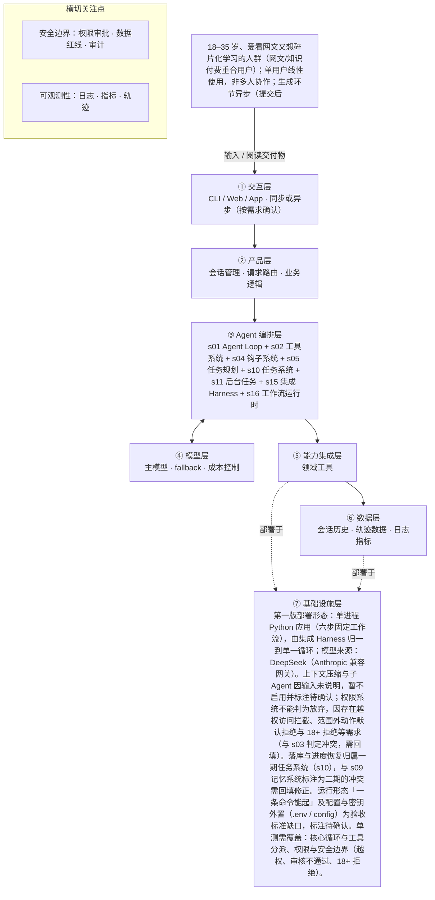

# PRD 推导方案 ——「网文阅读 × 学习关卡」

> 状态：方案待确认（审稿未完全通过，见文末审稿意见）（Step 1–4 已完成，Step 5 代码生成需确认后启动）
> 推导引擎：Agent Blueprint · 模型：anthropic

## 产品定位（一句话）

**网文阅读 × 学习关卡**：给 18–35 岁爱看网文又想碎片化学习的人群，用按章生成的个性化小说加配套测验，把学习打卡变成追文的爽感

## ⚠️ 待确认清单（答不上就是风险点）

1. 「周留存 ≥ 30%」的统计口径是什么（自然周内至少几次登录/几次答题？），在什么时间窗内验证？
2. 使用频率预期如何？用户一天读几章、一周读几章？
3. 异步生成完成后的「通知用户回来阅读」是通过什么方式实现？输入说 MVP 先不做消息推送，那第一版靠什么触达？
4. 系统必须调用的外部系统清单是什么？除模型服务与账号登录外，是否还有内容审核服务、存储服务需要接入？
5. 模型必须知道的规则、文档、schema 具体指什么？「考点白名单」补丁的形式与来源是什么，由谁维护？
6. 安全红线的判定标准由谁定义、用什么模型或服务执行审核？审核不通过重写的次数上限是多少？
7. 未成年用户被识别后的处理流程是什么？家长同意与内容分级具体怎么落地？
8. 工具失败、模型幻觉、超时、越权时各自的降级策略在工程上如何实现（具体重试次数、超时阈值、争议题标记的数据结构）？
9. 「不扣用户额度」中的额度体系是什么？如果 MVP 无支付，额度概念如何存在？
10. 成本「单章控制在几分钱以内」对应的 max_tokens 护栏具体数值是多少？按什么单价估算？
11. 答题正确率自动调难度由什么组件实现，判定的时间窗口与调整幅度是多少？
12. 「单章完读率」「答题正确率」的埋点与统计口径如何定义？
13. 「答对」的判定口径未明确：答对几题算通过并解锁下一章？
14. 消息推送为二期时，notify_user 的具体回站机制（站内提示 / 邮件 / 其他渠道）是什么？
15. 周留存与单章完读率的采集锚点：由端上采集还是服务端上报？上报口径如何对齐 PRD 指标？
16. 内容审核能力的具体来源（外部审核 API / 模型自审 / 规则）在输入中未说明，moderate_content 来源待确认。
17. 难度调整的实现层与触发方（校验层自动调 vs 人工），输入仅给出「自动调整难度」的目标。
18. 单章生成失败时的重试次数上限与超时重排阈值。
19. 运行形态是否要求「一条命令能起」及配置与密钥外置（.env / config）。
20. s03 权限系统被规则判为放弃，但与要素 permissions 五条规则及 unlock_next_chapter、notify_user 的权限设置冲突，需回填修正归属。
21. s09 记忆系统与 s17 目标闭环判为二期，却承载一期的落库、进度恢复与难度调整职责，归属需修正。
22. 是否会出现上下文爆炸的子任务或可并行的探索型子任务（s06 子 Agent 待确认）。
23. 会话是否很长、工具输出或日志量是否很大，是否需要上下文压缩（s08 待确认）。
24. 是否需要接入外部工具生态（MCP、第三方插件）（s14 待确认）。
25. 边界中「不做未成年人版本」是否还需处理家长同意与内容分级条件分支。
26. 【组件 s06 子 Agent】是否会出现上下文爆炸的子任务，或可并行的探索型子任务？
27. 【组件 s08 上下文压缩】会话是否很长、工具输出或日志量是否很大？
28. 【组件 s14 MCP 插件】是否需要接入外部工具生态（MCP、第三方插件）？

## Step 1 · 需求拆解（提取硬事实）

| 维度 | 结论 | 状态 | 出处 |
|---|---|---|---|
| 目标 | 按用户选定的类型与学习主题逐章生成个性化小说与配套测验，答对解锁下一章；核心成功标准为周留存 ≥ 30%，辅助指标为单章完读率 ≥ 60%、答题正确率维持在 50%–70% | 明确 | 核心指标：周留存 ≥ 30%；辅助指标：单章完读率 ≥ 60%；答题正确率 50%–70%（太低太高的题都需自动调整难度） |
| 用户 | 18–35 岁、爱看网文又想碎片化学习的人群（网文/知识付费重合用户）；单用户线性使用，非多人协作；生成环节异步（提交后先返回，后台生成，完成后通知用户回来阅读），阅读与答题环节同步交互 | 明确 | 18–35 岁、爱看网文又想碎片化学习的人群（网文/知识付费重合用户）；单用户线性使用，非多人协作；生成采用「异步」……阅读与答题为同步交互 |
| 核心闭环 | 用户选小说类型 → 输入想学的主题 → 设定章节数与每章篇幅 → 系统逐章生成故事（异步，单章 3 分钟内）→ 用户阅读该章并做 5 道测验 → 答对解锁下一章入口 → 进入下一章，循环至设定章节数完成 | 明确 | 1. 用户选小说类型……5. 支持只输入一个词或知识点，立刻生成对应短篇与测验；按章交付，不整本一次生成；每章生成后解锁下一章的入口 |
| 交付物 | 文本型交付物：单章 1500–2500 字小说正文 + 5 道配套测验题，按章交付并逐个解锁 | 明确 | 单章 1500–2500 字正文 + 5 道配套测验题；按章交付，不整本一次生成 |
| 边界 | 不做：整本一次性生成、独立题库、支付、消息推送（二期）；安全红线：生成内容必须过审核（不写暴力/色情/违法/危险模仿内容，不过则重写）；仅面向成年人（18+），不做未成年人版本；明确标注「AI 生成内容」，不改编现实真实网文 | 明确 | 先不做：独立题库、支付、消息推送（二期）；内容审核……不过则重写；年龄保护：面向成年人（18+），不做未成年人版本；版权声明：明确「AI 生成内容」，不改编现实真实网文 |
| 约束 | 时延：异步生成，单章 3 分钟内完成可接受；成本：单章控制在几分钱以内，设定 max_tokens 护栏；篇幅硬限制：单章 1500–2500 字 + 5 道题；模型：DeepSeek（Anthropic 兼容网关）；技术栈：第一版为单进程 Python 应用，六步固定工作流 | 明确 | 时延：异步生成，单章 3 分钟内完成可接受；成本：单章控制在几分钱以内；设定 max_tokens 护栏；篇幅硬限制：单章 1500–2500 字 + 5 道题；第一版：单进程 Python 应用，DeepSeek 模型（Anthropic 兼容网关）；六步固定工作流 |

## Step 2 · 领域建模（映射 Harness 五要素）

| 要素 | 内容 |
|---|---|
| **工具** | 调用 DeepSeek 模型（Anthropic 兼容网关）生成单章 1500–2500 字小说正文与 5 道配套测验题，并设置 max_tokens 护栏控制单章成本在几分钱以内。；调用内容审核能力对每章生成内容做安全检查，不通过则触发重写。；生成完成后写入章节与配套测验题的存储，并按章标记解锁状态，供用户答对后解锁下一章入口。；在后台异步生成流程结束后向用户发出「已完成、可回来阅读」的通知（消息推送列为二期，仅保留通知用户回到应用的机制）。 |
| **知识** | 小说类型与学习主题的对应设定知识，用于把用户输入的一个词或知识点扩展为短篇故事与测验。；章节篇幅规则：单章 1500–2500 字、每章固定 5 道测验题，作为生成与校验的业务规则。；测验难度规则：答题正确率需维持在 50%–70%，题目过难或过易时自动调整难度。；内容安全与合规规则：不写暴力/色情/违法/危险模仿内容，仅面向 18+ 成年人，明确标注「AI 生成内容」，不改编现实真实网文。；六步固定工作流的流程知识，约束第一版单进程 Python 应用的生成顺序。 |
| **观察** | 每章生成耗时是否在 3 分钟内完成，用于确认异步生成满足时延约束。；生成文本的字数是否落在 1500–2500 字区间、测验题是否为 5 道，用于校验篇幅硬限制。；内容审核结果（通过 / 不通过并重写）作为生成内容是否可交付的判定依据。；用户答题正确率统计，用于判断是否落在 50%–70% 区间并触发难度调整。；单章完读率与周留存数据，用于确认单章完读率 ≥ 60%、周留存 ≥ 30% 的成功标准。；每章生成的成本记录，用于确认单章成本是否控制在几分钱以内。 |
| **行动** | 以 API 形式调用 DeepSeek 模型完成章节正文与测验题的生成。；以异步任务形式执行生成：用户提交后先返回，后台生成完成再通知用户回来阅读。；以同步交互形式在 UI 中完成小说阅读与 5 道测验答题，答对后解锁下一章入口。；用户通过输入小说类型、学习主题、章节数与每章篇幅来设定生成参数。 |
| **权限** | 生成内容默认必须通过审核才可交付，未通过则拒绝发布并重写。；默认拒绝面向未成年人的使用，仅允许 18+ 成年人访问（不做未成年人版本）。；默认拒绝生成暴力、色情、违法、危险模仿类内容。；默认拒绝改编现实真实网文，且输出必须标注「AI 生成内容」。；支付与独立题库为一期范围外，默认不开放相应动作。 |

## Step 3 · 组件选型（宁可少选）

| 组件 | 选否 | 理由 | 参考 |
|---|---|---|---|
| s01 Agent Loop | ✅ 必选 | 一切基础：循环 + 工具（一切基础，恒选） | s01_agent_loop/README.md |
| s02 工具系统 | ✅ 必选 | 需要调用外部系统/API/数据源（一切基础，恒选） | s02_tool_use/README.md |
| s03 权限系统 | ❌ 放弃 | MVP 外部动作仅为模型服务调用与账号进度存储，明确先不做支付、消息推送，未提及删除或写入外部系统的破坏性操作 | s03_permission/README.md |
| s04 钩子系统 | ✅ 必选 | 安全红线要求生成的小说必须过内容审核，不过则重写，且需明确标注「AI 生成内容」 | s04_hooks/README.md |
| s05 任务规划 | ✅ 必选 | 六步固定工作流（选类型 → 输主题 → 设篇幅 → 逐章生成 → 出题 → 解锁），且按章逐个交付并解锁 | s05_todo_write/README.md |
| s06 子 Agent | ❓ 待确认 | 输入未说明：是否会出现上下文爆炸的子任务，或可并行的探索型子任务？ | s06_subagent/README.md |
| s07 技能加载 | ❌ 放弃 | 先靠模型内置知识，不做独立考点库；后期才针对高频主题做「考点白名单」补丁 | s07_skill_loading/README.md |
| s08 上下文压缩 | ❓ 待确认 | 输入未说明：会话是否很长、工具输出或日志量是否很大？ | s08_context_compact/README.md |
| s09 记忆系统 | ⏸ 二期 | 建议有账号登录（存进度），但未提出跨会话记忆用户偏好、决策、历史的需求 | s09_memory/README.md |
| s10 任务系统 | ✅ 必选 | 生成采用异步，用户提交后先返回、后台生成、完成后通知用户回来阅读，且按章解锁需保存进度 | s10_task_system/README.md |
| s11 后台任务 | ✅ 必选 | 异步生成、单章 3 分钟内完成可接受，属不阻塞主流程的慢操作 | s11_background_tasks/README.md |
| s12 定时调度 | ❌ 放弃 | 输入未提及定时触发，交互由用户提交生成请求驱动 | s12_cron_scheduler/README.md |
| s13 Agent 团队 | ❌ 放弃 | 单用户线性使用，非多人协作；第一版为单进程 Python 应用 | s13_agent_teams/README.md |
| s14 MCP 插件 | ❓ 待确认 | 输入未说明：是否需要接入外部工具生态（MCP、第三方插件）？ | s14_mcp_plugin/README.md |
| s15 集成 Harness | ✅ 必选 | 第一版已选 5 个可选组件（s04, s05, s10, s11, s16），需归一到单一循环 | s15_integrated_harness/README.md |
| s16 工作流运行时 | ✅ 必选 | 第一版明确采用六步固定工作流：选类型 → 输主题 → 设篇幅 → 逐章生成 → 出题 → 解锁 | s16_workflow_runtime/README.md |
| s17 目标闭环 | ⏸ 二期 | 答题正确率需维持在 50%–70%，太低太高的题都需自动调整难度，暗示需要自动评估，但输入未明确要求独立评估器判断「何时算完成」 | s17_goal_loop/README.md |

特征判定依据：

- `destructive_ops` = no：MVP 外部动作仅为模型服务调用与账号进度存储，明确先不做支付、消息推送，未提及删除或写入外部系统的破坏性操作
- `audit_needed` = yes：安全红线要求生成的小说必须过内容审核，不过则重写，且需明确标注「AI 生成内容」
- `multi_step` = yes：六步固定工作流（选类型 → 输主题 → 设篇幅 → 逐章生成 → 出题 → 解锁），且按章逐个交付并解锁
- `context_heavy` = unknown：输入只给出单章 1500–2500 字篇幅与不做独立考点库，未说明是否存在上下文爆炸或可并行探索型子任务
- `large_knowledge` = no：先靠模型内置知识，不做独立考点库；后期才针对高频主题做「考点白名单」补丁
- `long_sessions` = unknown：输入未描述会话长度或工具输出/日志量规模
- `cross_session_memory` = later：建议有账号登录（存进度），但未提出跨会话记忆用户偏好、决策、历史的需求
- `persistent_goals` = yes：生成采用异步，用户提交后先返回、后台生成、完成后通知用户回来阅读，且按章解锁需保存进度
- `slow_operations` = yes：异步生成、单章 3 分钟内完成可接受，属不阻塞主流程的慢操作
- `scheduled` = no：输入未提及定时触发，交互由用户提交生成请求驱动
- `parallel_isolated` = no：单用户线性使用，非多人协作；第一版为单进程 Python 应用
- `external_ecosystem` = unknown：仅提到必须接入模型服务（DeepSeek 网关，Anthropic 兼容），未提 MCP 或第三方插件生态
- `fixed_orchestration` = yes：第一版明确采用六步固定工作流：选类型 → 输主题 → 设篇幅 → 逐章生成 → 出题 → 解锁
- `auto_completion` = later：答题正确率需维持在 50%–70%，太低太高的题都需自动调整难度，暗示需要自动评估，但输入未明确要求独立评估器判断「何时算完成」

## Step 4 · 架构设计

### 分层架构图（7 层 + 数据流）



| 层 | 名称 | 回答的问题 | 落地锚点 |
|---|---|---|---|
| ① | 交互层 | 谁在用、怎么用？ | CLI / Web / App / API；同步或异步；人机比 |
| ② | 产品层 | 产品外壳是什么？ | 会话管理、请求路由、账户、业务逻辑 |
| ③ | Agent 编排层 | Harness 如何运转？ | loop、工具分发、hooks、权限、记忆、任务、技能、压缩、子 agent / 团队、目标闭环 |
| ④ | 模型层 | 智能从哪来？ | 主模型、辅助模型、路由、fallback、成本 |
| ⑤ | 能力集成层 | 如何触达外部世界？ | 内部工具、MCP server、知识库、第三方 API |
| ⑥ | 数据层 | 什么需要持久化？ | 记忆、任务、会话历史、轨迹数据、日志指标 |
| ⑦ | 基础设施层 | 如何部署运行？ | 单进程 / 服务 / 团队、沙箱、队列、调度、监控 |

### 工具清单

| 工具 | 输入 | 输出 | 副作用 | 权限 | 归属层 |
|---|---|---|---|---|---|
| `generate_chapter` | 小说类型、学习主题（一个词或知识点）、章节序号、每章篇幅设定（1500–2500 字）、max_tokens 护栏 | 单章 1500–2500 字小说正文 + 5 道配套测验题（含答案与难度标注） | 调用 DeepSeek 模型（Anthropic 兼容网关），产生 token 成本与生成耗时记录 | allow | ③工具层 |
| `moderate_content` | 待审的章节正文与测验题文本 | 审核结果（通过 / 不通过 + 违规类型），不通过时返回重写指令 | 审核不通过时触发重写，未通过内容不进入交付存储 | allow | ③工具层 |
| `save_chapter` | 章节序号、已过审的正文与测验题、解锁状态标记 | 存储写入结果（成功 / 失败） | 写入章节与配套测验题，按章标记解锁状态 | allow | ④存储层 |
| `unlock_next_chapter` | 用户标识、当前章节序号、答题通过判定结果、答对判定口径（待确认） | 下一章入口是否解锁的结果 | 写操作：更新用户进度与章节解锁状态 | ask | ⑥业务动作层 |
| `run_async_generation` | 用户提交的生成参数（类型、主题、章节数、每章篇幅） | 异步任务已受理的回执（用户先返回） | 在后台执行逐章生成，不阻塞主流程；受单章 3 分钟时延约束 | allow | ⑤任务调度层 |
| `notify_user` | 用户标识、已完成章节序号 | 通知已发出 / 用户已回到应用的消息 | 在生成完成后通知用户回来阅读；消息推送为二期，仅保留回站通知机制（渠道待确认） | ask | ⑥业务动作层 |
| `check_chapter_quality` | 生成正文的字数、测验题数量（应为 5 道）、答题正确率数据 | 篇幅与题量是否达标、正确率是否落在 50%–70% 区间的校验结论 | 不达标时按生成与校验业务规则触发重写或标记难度调整需求（难度调整实现层待确认） | allow | ③工具层 |

### 系统提示词草案

```
你是「网文阅读 × 学习关卡」的章节生成 Agent，服务 18–35 岁爱看网文又想碎片化学习的成年人（18+），不提供未成年人版本。

身份与流程：按六步固定工作流运行——选类型 → 输主题 → 设篇幅 → 逐章生成 → 出题 → 解锁。按章交付，不整本一次生成；每章答对判定后解锁下一章入口。

规则：
1. 边界：不写暴力、色情、违法、危险模仿内容；不改编现实真实网文；输出必须明确标注「AI 生成内容」；不提供支付与独立题库。
2. 质量底线：单章正文 1500–2500 字，固定 5 道测验题；生成内容必须通过内容审核才可交付，不通过则重写。
3. 成本与篇幅：受 max_tokens 护栏约束，单章成本控制在几分钱以内，单章生成 3 分钟内完成。

工具说明：generate_chapter（生成正文与题）、moderate_content（内容审核）、save_chapter（落库与解锁标记）、unlock_next_chapter（写操作需确认）、run_async_generation（异步后台生成）、notify_user（通知回站）、check_chapter_quality（篇幅/题量/正确率校验）。

知识目录：小说类型与学习主题对应设定、章节篇幅规则、测验难度规则（正确率维持 50%–70%，调难度机制由外层校验触发，非模型自行判断）、内容安全与合规规则、六步固定工作流。
```

### 上下文与记忆策略

会话内：每章生成时从会话上下文取用户设定的生成参数与当前章节序号，不回溯已交付章节全文，仅保留章节摘要与解锁状态；工具输出（如审核结果）只保留结论与违规类型，不保留全文，以控制上下文。跨会话：生成参数与解锁状态落库，会话中断后可恢复进度（持久化内容为：小说类型、学习主题、章节总数、每章篇幅、当前章节序号、已解锁章节、答对判定口径待确认后写入）。输入未提出跨会话记忆用户偏好、决策、历史的需求，跨会话的偏好记忆列为二期；未说明会话长度与工具输出/日志量级别，是否需上下文压缩标注待确认。

### 安全边界与降级策略

- 工具失败：generate_chapter 调用失败或返回不完整 → 记录失败原因，按重试策略重试；重试上限（如 3 次）后中止该章生成并保留已完成章节，生成失败不扣用户额度。
- 模型幻觉：生成正文偏离用户所选类型/学习主题，或题量不足 5 道、字数不在 1500–2500 字 → 触发 check_chapter_quality 校验不达标，重写该章，仍不达标则标记为人工待审并暂停解锁。
- 超时：单章生成超过 3 分钟 → 视为超时，中止当前任务并重排（重排阈值与最大排队时长待确认），通知用户该章仍在生成中，不阻塞已解锁章节的阅读与答题。
- 越权：访问未解锁章节或他人进度 → 拒绝访问并记录，不回传未解锁内容；范围外动作（支付、独立题库、消息推送）默认拒绝；未成年人访问默认拒绝，仅允许 18+ 成年人。
- 内容审核不通过 → 拒绝发布并重写（违规类型保留用于调优）；重写次数阈值与最终止损口径待确认，超过阈值则停止该章交付。
- 通知失败：notify_user 在消息推送为二期的情况下仅保留回站通知，渠道失败 → 退化为应用内提示，用户回到应用可见已完成章节。
- 答题正确率超出 50%–70% 区间 → 触发题目难度调整需求；难度调整的实现层与触发方待确认，提示词不承担该判定职责。

### 可观测性

- 日志：每章生成请求：章节序号、生成参数、max_tokens 设置、开始与结束时间；内容审核结果：通过 / 不通过 + 违规类型 + 是否触发重写；解锁动作：用户标识、章节序号、写操作确认结果；工具调用失败与重试链：工具名、失败原因、重试次数与最终结论
- 指标：PRD 成功指标（优先级最高）：周留存 ≥ 30%、单章完读率 ≥ 60%、答题正确率 50%–70%；约束指标（优先级次之）：单章生成耗时（3 分钟内）、单章成本（几分钱以内）
- 轨迹：按「用户标识 + 章节序号」记录每章的完整轨迹：生成参数 → 模型调用 → 审核结论 → 篇幅/题量校验 → 落库 → 解锁 → 用户答题结果，用于复盘失败章节与难度调整。

### 技术栈与部署形态

第一版部署形态：单进程 Python 应用（六步固定工作流），由集成 Harness 归一到单一循环；模型来源：DeepSeek（Anthropic 兼容网关）。上下文压缩与子 Agent 因输入未说明，暂不启用并标注待确认；权限系统不能判为放弃，因存在越权访问拦截、范围外动作默认拒绝与 18+ 拒绝等需求（与 s03 判定冲突，需回填）。落库与进度恢复归属一期任务系统（s10），与 s09 记忆系统标注为二期的冲突需回填修正。运行形态「一条命令能起」及配置与密钥外置（.env / config）为验收标准缺口，标注待确认。单测需覆盖：核心循环与工具分派、权限与安全边界（越权、审核不通过、18+ 拒绝）。

## 验收标准对照（可落地 vs demo）

| 标准 | 要求 | 本方案的对应设计 |
|---|---|---|
| 可运行 | 一条命令能起，配置与密钥外置（.env / config） | 第一版部署形态：单进程 Python 应用（六步固定工作流），由集成 Harness 归一到单一循环；模型来源：DeepSeek（Anthropic 兼容网关）。上下文压缩与子 Agent 因输入未说明，暂不启用并标注待确认；权限系统不能判为放弃，因存在越权访问拦截、范围外动作默认拒绝与 18+ 拒绝等需求（与 s03 判定冲突，需回填）。落库与进度恢复归属一期任务系统（s10），与 s09 记忆系统标注为二期的冲突需回填修正。运行形态「一条命令能起」及配置与密钥外置（.env / config）为验收标准缺口，标注待确认。单测需覆盖：核心循环与工具分派、权限与安全边界（越权、审核不通过、18+ 拒绝）。 |
| 可容错 | 工具失败、模型幻觉、超时、越权都有明确降级路径 | 工具失败：generate_chapter 调用失败或返回不完整 → 记录失败原因，按重试策略重试；重试上限（如 3 次）后中止该章生成并保留已完成章节，生成失败不扣用户额度。；模型幻觉：生成正文偏离用户所选类型/学习主题，或题量不足 5 道、字数不在 1500–2500 字 → 触发 check_chapter_quality 校验不达标，重写该章，仍不达标则标记为人工待审并暂停解锁。；超时：单章生成超过 3 分钟 → 视为超时，中止当前任务并重排（重排阈值与最大排队时长待确认），通知用户该章仍在生成中，不阻塞已解锁章节的阅读与答题。 |
| 可观测 | 有日志、有指标、有轨迹数据 | 每章生成请求：章节序号、生成参数、max_tokens 设置、开始与结束时间；内容审核结果：通过 / 不通过 + 违规类型 + 是否触发重写；PRD 成功指标（优先级最高）：周留存 ≥ 30%、单章完读率 ≥ 60%、答题正确率 50%–70%；约束指标（优先级次之）：单章生成耗时（3 分钟内）、单章成本（几分钱以内） |
| 可测试 | 核心循环与工具分派有单测，权限与安全有边界测试 | Step 5 骨架层需附核心循环与权限边界的单测 |
| 可部署 | 有明确的部署形态（单进程 / 服务 / 团队）与启动文档 | 第一版部署形态：单进程 Python 应用（六步固定工作流），由集成 Harness 归一到单一循环；模型来源：DeepSeek（Anthropic 兼容网关）。上下文压缩与子 Agent 因输入未说明，暂不启用并标注待确认；权限系统不能判为放弃，因存在越权访问拦截、范围外动作默认拒绝与 18+ 拒绝等需求（与 s03 判定冲突，需回填）。落库与进度恢复归属一期任务系统（s10），与 s09 记忆系统标注为二期的冲突需回填修正。运行形态「一条命令能起」及配置与密钥外置（.env / config）为验收标准缺口，标注待确认。单测需覆盖：核心循环与工具分派、权限与安全边界（越权、审核不通过、18+ 拒绝）。 |
| 可度量 | 有对齐 PRD 的成功指标，并能采集 | PRD 成功指标（优先级最高）：周留存 ≥ 30%、单章完读率 ≥ 60%、答题正确率 50%–70%；约束指标（优先级次之）：单章生成耗时（3 分钟内）、单章成本（几分钱以内） |

## 独立审稿意见

- 结论：❌ 未通过（62 / 100），设计稿共 2 版
- 总评：方案在事实抽取层（goal、users、deliverable、boundaries、constraints）较为完整且来源标注清晰，五要素与工具清单基本可对应，安全降级也覆盖了工具失败、幻觉、超时、越权四类。但存在多处 high 级问题：s03 权限系统判「放弃」与要素 permissions 五条规则、工具 permission 字段、越权降级路径相互冲突；s17/s09 判「二期」却承载一期职责；答对判定口径与解锁工具权限（ask）与核心闭环冲突；模型幻觉与审核降级路径被改写为「暂停解锁 / 停止交付」，与 PRD「绝不卡死用户」原则背离；部署与启动文档、可测试用例、指标采集锚点在设计中实质空缺。方案自述已承认部分冲突却未回填，故 ok 应为 false。
- [high] design.tool_list / unlock_next_chapter：把写操作解锁下一章的权限设为 ask（需确认），但 PRD 明确「答对才能解锁下一章」应为自动判定解锁，ask 会引入人工确认环节，与核心闭环冲突，且 ask 的确认方未定义。
- [medium] design.tool_list / notify_user：notify_user 的 permission 设为 ask，但通知用户回站属于无破坏性的低风险动作，无需人工授权；且其触发在异步流程中无人在场确认，设计不可执行。
- [high] components.s03 权限系统：s03 判为「放弃」，但同份方案的要素 permissions 列出五条规则、design 中 unlock_next_chapter 与 notify_user 均设定了 permission 字段、security_and_degradation 中有越权拦截与范围外动作默认拒绝，判定与设计自相矛盾（方案自身也已在 tech_stack 与 open_questions 中承认冲突，但仍未修正），违反审查标准第 5 条与一致性要求。
- [medium] components.s07 技能加载：s07 放弃的理由为「不做独立考点库 / 后期考点白名单」，但 elements.knowledge 已列出 5 条知识（类型-主题对应设定、篇幅规则、难度规则、安全合规规则、六步流程知识），符合 large_knowledge 特征的实质；放弃与知识要素的存在不匹配。
- [high] components.s17 目标闭环 / s09 记忆系统：s17、s09 均判为「二期」，但 s10 任务系统承载的进度落库、解锁状态与 design 中的进度恢复、难度调整校验其实是一期能力，归属与 decision 冲突，方案自身也已标注需回填但未修正。
- [medium] design.security_and_degradation / 工具失败：PRD 明确生成失败「自动重试 1–2 次」，方案写成「重试上限（如 3 次）」，与输入给定的 1–2 次不一致，属对输入事实的改写。
- [high] design.security_and_degradation / 模型幻觉：PRD 对幻觉的处理是「标记此题有争议，已跳过，不卡用户」，方案改为「触发校验不达标、重写该章，仍不达标则人工待审并暂停解锁」，引入了 PRD 未要求的暂停交付路径，与「绝不卡死用户」原则冲突。
- [medium] design.security_and_degradation / 内容审核：PRD 只说「不过则重写」，方案补充「重写次数阈值与最终止损口径待确认」「超过阈值则停止该章交付」，止损口径为方案新增且未标注来源，属编造风险内容。
- [high] design.tech_stack_and_deployment / 部署：审查标准第 2 条要求「可运行：一条命令能起、配置与密钥外置（.env / config）」「可部署：明确部署形态与启动文档」，方案仅说明单进程 Python 应用，启动文档与配置外置被列为待确认，此验收标准在设计层面确为空缺。
- [medium] design.tool_list / check_chapter_quality：check_chapter_quality 的 input 含「答题正确率数据」，但正确率在用户答题后才有数据，与生成阶段校验的时序不一致，工具职责边界不清。
- [high] design.tool_list：unlock_next_chapter 的 input 中「答对判定口径（待确认）」，而 PRD 明确「答对才能解锁」；答对判定口径属关键业务规则，未确认即进入工具定义，存在未闭合的关键逻辑。
- [medium] review 标准 2 / 可测试：方案在 tech_stack 中提及单测需覆盖核心循环、工具分派与权限安全边界，但未给出任何测试清单、用例或断言口径，验收标准「可测试」缺乏可执行设计。
- [medium] review 标准 2 / 可度量：可观测中列出周留存、完读率、正确率等指标，但采集锚点、上报口径在 open_questions 中仍为待确认，指标无法落地采集。
- [low] components.s16 / elements.action：s16 工作流运行时判定为「必选」，但其 feature 标记为 fixed_orchestration，而 s05 任务规划亦以六步流程为由判必选，两者职责重叠且未说明边界，存在重复建设嫌疑。
- [low] components.s15 集成 Harness：s15 判定理由为「已选 5 个可选组件（s04, s05, s10, s11, s16），需归一到单一循环」，但 s04/s05/s10/s11/s16 中多项被标为必选组件而非可选组件，理由措辞与事实不符。
- [low] facts.core_loop：core_loop 中写入「（异步，单章 3 分钟内）」为输入事实，但「单章 3 分钟内」在 PRD 中属于时延约束（constraints），归入核心闭环描述会对事实做位置迁移，虽内容一致但归类不严谨。
- [medium] design.security_and_degradation / 越权：越权描述「访问未解锁章节或他人进度」，但 PRD 明确「单用户线性使用，非多人协作」，未提及多用户数据隔离需求；「他人进度」越权场景为方案自行引入，未标注待确认。
- [medium] design.system_prompt：系统提示词写入「调难度机制由外层校验触发，非模型自行判断」，此为实现决策，PRD 未指定难度调整实现方（方案自身在 open_questions 亦列为待确认），提示词中写入未确认结论，存在编造。

## 本次推导消耗

- 模型调用 6 次，输入 14786 tokens，输出 10063 tokens

## 下一步

回答上面的待确认清单，据此修订方案后，再进入 Step 5 代码生成（骨架 → 硬化 → 产品化）。
